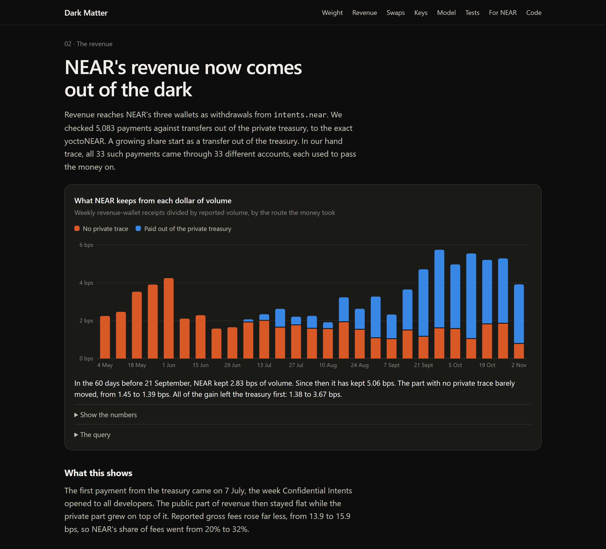

# Dark Matter

An investment thesis for NEAR that measures the part of NEAR nobody can see. Built at NEAR HACKATHON
2026, track `thesis`. Research, not financial advice.

- **Live site:** site/index.html (published with GitHub Pages)
- **Thesis:** [THESIS.md](THESIS.md)
- **Method:** [docs/METHOD.md](docs/METHOD.md)
- **Contract:** [contract/](contract/README.md)
- **Draft proposal for the House of Stake:** [governance/HSP-DRAFT.md](governance/HSP-DRAFT.md)

## The problem

NEAR's investment case rests on NEAR Intents revenue. Public dashboards measure that from `intents.near`
event logs. But Confidential Intents settles swaps on a private chain with no public RPC or explorer, and a
growing share of the money now moves there. Dashboards built on public data see less of NEAR every day,
and the revenue they report can no longer be traced to the swaps that earned it.

## What this does

It measures the private economy from the one public place it has to cross: a single treasury account on
`intents.near`. Every shielded token is held there, and every transfer in and out is a public event.

<!-- results:start (generated from data/derived/numbers.json) -->
| Finding | Number |
|---|---|
| Value in the private treasury, weighed from chain data | **$141.3M**, within 0.4% of NEAR's reported $141.9M |
| Share of NEAR's revenue paid out of the treasury, last 30 days | **72%** (a floor), against 0% in June |
| Revenue per dollar of volume since 21 September | **5.06 bps**, against 2.83 bps in the 60 days before |
| The part of that with no private trace | Flat: 1.45 to 1.39 bps |
| The part that left the treasury first | 1.38 to **3.67 bps** |
| Keys registered for the treasury | **1**, the same at all 10 dates checked |
| Private swaps seen per hour at the boundary | 18 before 27 October, 519 since |
| Revenue per dollar since 27 October | 4.56 bps, −14% on the 30 days before. **This is the live test** |
| Value of new NEAR paid for by revenue | 19% |
<!-- results:end -->

**The short version:** From September, what NEAR keeps from each dollar of volume went from 2.83 to 5.06 bps, and all of the gain arrived through the private treasury. Then on 27 October swaps themselves moved to the private chain, about 29 times as many crossed the boundary, and the take slipped to 4.56 bps. Nothing public links a revenue payment to a swap, one key signs for the treasury, and the private fee is set off-chain. Holders can see that money arrived. They cannot check what earned it, or whether private swaps pay NEAR at all.

## Try it

Python 3.10+ and nothing else. No keys, no network for steps 1 to 3.

| Do | See |
|---|---|
| `git clone https://github.com/OWNER/dark-matter && cd dark-matter` | The repository, with all raw data committed |
| `python rebuild.py` | Every number recomputed from `data/raw`, unit tests, then an independent recalculation. It ends with `ALL CHECKS PASS` |
| Open `site/index.html` in a browser | The dashboard: each chart with its query and one plain sentence |
| On the site, click **Weigh it yourself** | Your browser reads the treasury from a public NEAR node and values it with live prices. No server of ours is involved |
| Move the sliders in section 05 | The break-even volume changes with the share of volume on the private path |
| Open **The query** under any chart | The exact call behind it |
| `python pipeline/weigh_now.py` | The same live reading from the command line |
| `cd contract && cargo test` | 36 contract tests pass (Rust 1.96) |
| `cd contract/vm-test && cargo run --release -- ../target/wasm32-unknown-unknown/release/dark_matter.wasm fixture.json` | The compiled contract runs in NEAR's own VM with mainnet settings and real balances, and ends with `ALL VM CHECKS PASS` |
| `python rebuild.py --fresh` | Downloads all data again, with no keys. Slow, because public APIs are rate-limited |

For agents, see [AGENTS.md](AGENTS.md).

## What is in the repository

| Path | What it is |
|---|---|
| `THESIS.md` | The claim, the evidence for it, the evidence against it, and what would change our mind |
| `site/` | The static dashboard and an open data feed in `site/data/` |
| `data/raw/` | Raw public data, hashed in `data/manifest.json` |
| `pipeline/` | Fetching, formulas, analysis, site build and verification. Standard library only |
| `sql/` | Daily active accounts, transactions and contract usage for the NEAR BigQuery dataset |
| `contract/` | The weigh station: a NEAR contract that reads the treasury from `intents.near` with no oracle |
| `mcp/` | A Model Context Protocol server, so AI agents can use the same numbers |
| `governance/` | A draft House of Stake proposal for publishing private totals |

## How NEAR fits

- **`intents.near`:** every number starts from this contract's public state and events.
- **A NEAR contract:** `contract/` reads the treasury in a cross-contract call and warns on chain if its keys
  change or money leaves fast. `weigh()` can only run on mainnet, because Intents has no testnet (Q-007).
  Built and tested here, and ready to deploy: see `contract/README.md`.
- **Benefits for NEAR:** an open daily feed of private activity that nobody else publishes, a free security
  warning on the treasury, and a concrete proposal that keeps swaps private while giving holders totals
  they can check.

## How it meets the track

| The track asks for | Where |
|---|---|
| SQL against the NEAR BigQuery dataset, always filtered on `block_date` | `sql/`, run by `pipeline/run_bigquery.py`. The same metrics come from NearBlocks with no key, so a Google account is optional |
| A pull from the NEAR Intents Explorer API | `pipeline/fetch_explorer.py`. It needs a partner JWT, and the API terms bar keeping the data, so nothing here depends on it |
| One command that rebuilds every chart from raw data | `python rebuild.py` |
| A static dashboard: each chart, its query and one plain sentence | `site/index.html` |
| `THESIS.md`: claim, evidence for, evidence against, what would change my mind | [THESIS.md](THESIS.md) |
| Never invent numbers; say what cannot be computed | Every number comes from a placeholder filled by code. `THESIS.md` lists what could not be computed |

## Disclosures

- Written during the hackathon window, with no earlier code.
- Written with AI assistance (Claude Code). The analysis, code and text were generated with it.
- Libraries: Python standard library; `near-sdk` for the contract; `google-cloud-bigquery` only for the
  optional BigQuery run. Data from NEAR RPC, FastNear, DefiLlama, NearBlocks and revenue.near.org.
- Not affiliated with or endorsed by NEAR Foundation, NEAR Intents or Intents Technology.

MIT license. See [LICENSE](LICENSE).
